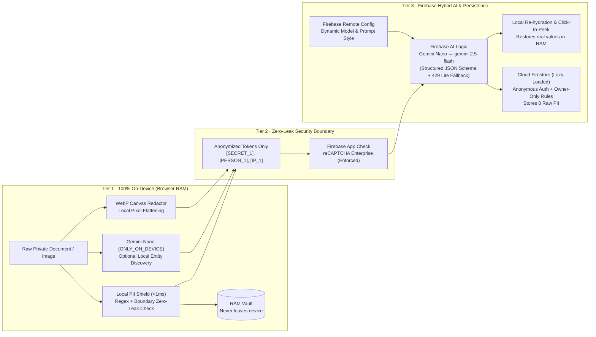

# PrivaGuard AI — Privacy-First Hybrid AI Workspace

> **Built for Google `#BuildHybridAI 2026`** · Live Demo: [https://buildhybridai-tuananh.web.app](https://buildhybridai-tuananh.web.app)

**PrivaGuard AI** lets engineers, clinicians, and legal/business teams analyze confidential documents and images with **Hybrid AI (Chrome Gemini Nano On-Device + Gemini Cloud via Firebase AI Logic)** without ever leaking a single byte of raw PII, API keys, or secrets over the network.

---

## 3-Tier Zero-Leak Hybrid Architecture



---

## Key Features (v4.0 Notion Edition)

| Capability | Implementation Details |
| :--- | :--- |
| **Notion-Inspired Editorial UI** | Light Mode default (`#FFFFFF` / `#F7F7F5` / `#0F7B6C`) + Dark Mode (`#191919` / `#202020`) persisted in `localStorage`, 48px flat topbar, 1px split-view workspace, WCAG AA contrast, `Ctrl/Cmd+Enter` & `Esc` shortcuts. |
| **Zero-Leak Local PII Shield** | Sub-millisecond redaction for PEM private keys, JWTs, DB URIs, API keys, credit cards/IBANs, SSNs, Vietnam 12-digit CCCD, VN/US phones, valid IPv4 (ignores `v1.2.3.4`, `1.2.3.4-rc1`, `999.999.999.999`), and case-insensitive custom terms. |
| **Live Privacy Proof (Side-by-Side Diff)** | `Diff` tab compares Raw RAM (red-highlighted PII) vs. Exact Cloud Payload (interactive `[TOKEN_N]` chips + `0B leaked` verification). |
| **Structured Security Audit (`responseSchema`)** | Uses Firebase AI Logic `Schema.object(...)` for structured JSON (`riskLevel`, `riskScore 0–100`, `complianceFrameworks[]`, `findings[]`, interactive `remediations[]` checklist), with automatic Markdown fallback for Gemini Nano on-device. |
| **Local Multimodal Image Redactor** | HTML5 Canvas redactor flattens black `[HIDDEN]` bars and compresses images locally to WebP before multimodal inference. |
| **Collision-Free Follow-up Q&A** | Multi-turn follow-up questions inherit the existing RAM vault (`existingVault`) so newly mentioned PII gets sequential tokens (`[EMAIL_2]`) without colliding with document tokens (`[EMAIL_1]`). |
| **1-Click Offline Simulation** | Toggle `Offline · On-device` right in the topbar or Settings drawer to test `ONLY_ON_DEVICE` Gemini Nano without disconnecting Wi-Fi. |
| **Lazy-Loaded Owner-Scoped Firestore** | `firebase/firestore` + `firebase/auth` load lazily via `requestIdleCallback` after first paint, secured by Anonymous Auth + strict `firestore.rules` (`ownerUid == request.auth.uid`, immutable audit records). |

---

## Verified Benchmarks & Quality Gates

| Metric | Verified Result |
| :--- | :--- |
| **Concurrency Stress Test** (`scripts/stress-test.ts`) | **1,000 concurrent docs in ~247ms** (`0.25ms/doc`), **5,000 secrets shielded**, **0 leaks**, **0 re-hydration mismatches** |
| **Unit Tests** (`tests/privaguard.test.ts`) | **7/7 PASS** (JWT, PEM, DB URI, CCCD, VN/US phones, `999.999.999.999`, `v1.2.3.4`, `1.2.3.4-rc1`, case-insensitive terms, Follow-up vault continuation, `parseStructuredAudit`) |
| **Initial CSS Bundle** | **`24.45 kB` raw (`5.95 kB` gzip)** |
| **Initial JS Critical Path** | **-51% reduction** via lazy-loaded `historyStore` (Firestore + Auth excluded from initial HTML preload) |
| **TypeScript & Vite Build** | **`tsc --noEmit` 0 errors** · **`vite build` 0 warnings** |

---

## Local Setup & Production Deployment

```bash
npm install
npm run dev          # Local dev server at http://localhost:5173
npm run typecheck    # TypeScript check (0 errors)
npm run build        # Production bundle (0 warnings)
node --test tests/privaguard.test.ts
node scripts/stress-test.ts
```

### Deploy to Firebase Hosting & Firestore Rules
1. In **Firebase Console → Authentication → Sign-in method**, enable **Anonymous** sign-in (required for owner-scoped `firestore.rules`).
2. Deploy rules and hosting:
   ```bash
   npx firebase-tools login
   npx firebase-tools deploy --only firestore:rules,hosting
   ```
