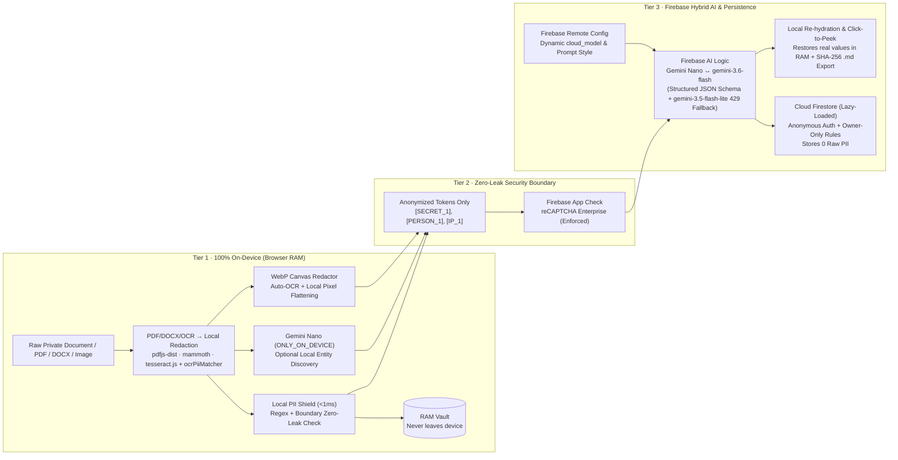

# PrivaGuard AI — Privacy-First Hybrid AI Workspace (v5.0)

> **Built for Google `#BuildHybridAI 2026`** · Live Demo: [https://buildhybridai-tuananh.web.app](https://buildhybridai-tuananh.web.app)

**PrivaGuard AI** lets engineers, clinicians, and legal/business teams analyze confidential documents (`.pdf`, `.docx`, `.txt`, `.md`, `.log`, `.json`, `.env`, `.csv`) and images with **Hybrid AI (Chrome Gemini Nano On-Device + Gemini Cloud via Firebase AI Logic)** without ever leaking raw PII, API keys, or secrets over the network.

---

## What's New in v5.0

- **Local PDF & DOCX Drag-and-Drop**: Drop `.pdf` or `.docx` files directly into the workspace (`pdfjs-dist` + `mammoth`, lazy-loaded via dynamic `import()`). Extracts up to 25 pages strictly inside browser RAM — the original file is never uploaded.
- **1-Click Auto-OCR PII Masking for Images**: Powered by lazy-loaded `tesseract.js` (`eng+vie`) + `ocrPiiMatcher` to automatically detect sensitive regions (emails, phones, IDs, API keys, card numbers, Vietnamese names/phones) and place editable black `[HIDDEN]` boxes on the Canvas before flattening to WebP.
- **SHA-256 Zero-Leak Proof Footer in Markdown Export**: Every exported `.md` audit report includes a cryptographic `SHA-256` digest of the anonymized payload and verification metadata (`0B raw PII leaked`) for compliance sign-off.

---

## 3-Tier Zero-Leak Hybrid Architecture



---

## 2-Minute Judge Walkthrough (4 "Aha!" Moments)

1. **Side-by-Side Diff + Payload Inspector (`0B leaked`)**: Open [https://buildhybridai-tuananh.web.app](https://buildhybridai-tuananh.web.app), pick a preset (e.g., **DevOps log**) or click **Try sample PDF**, then switch to the **Diff** tab. Raw PII is highlighted in red on the left while the exact cloud payload on the right contains only `[TOKEN_N]` placeholders with `0B leaked` verification.
2. **Structured Audit JSON + Click-to-Peek**: Press `Ctrl/Cmd+Enter` to run **Security audit**. Inspect the live Risk Score (`0–100`), compliance badges, and interactive remediation checklist. Click any `[SECRET_1]` chip to peek its real value from local RAM, toggle **Show real names** to re-hydrate locally, or export `.md` with the SHA-256 Zero-Leak proof footer.
3. **Local PDF Drag-and-Drop & Auto-OCR Image Masking**: Click **Try sample PDF** (or drop any `.pdf`/`.docx`) to extract text locally in browser RAM. Then click **Try sample image**, hit **Auto-detect PII (OCR)** to generate 1-click redaction boxes over ID/phone/email fields, and click **Apply mask** to flatten pixels locally to WebP.
4. **Offline Simulation → On-Device Gemini Nano**: Click the topbar status pill (**Offline · On-device**) to simulate an air-gapped environment and force `ONLY_ON_DEVICE` Gemini Nano via Firebase AI Logic — no Wi-Fi toggle required.

---

## Privacy Model

- **Text, PDF, DOCX, and Images stay on your device**: Document parsing (`pdfjs-dist`, `mammoth`), PII tokenization, Canvas pixel flattening, and OCR (`tesseract.js`) execute entirely inside your browser's RAM/WebAssembly sandbox. Raw files and raw PII are never uploaded.
- **OCR Language Model (Honest Disclosure)**: The first time you click **Auto-detect PII (OCR)**, the browser downloads the static Tesseract language model (`eng+vie`) once and caches it locally. Your image itself never leaves the device.
- **Zero-PII Cloud Boundary**: Only anonymized `[TOKEN_N]` text and pixel-flattened WebP images cross the network through Firebase App Check (reCAPTCHA Enterprise) to Firebase AI Logic (`gemini-3.6-flash` / `gemini-3.5-flash-lite` fallback). Cloud Firestore stores anonymized summaries only, scoped per Anonymous Auth `ownerUid`.

---

## Key Features (v5.0 Notion Edition)

| Capability | Implementation Details |
| :--- | :--- |
| **Notion-Inspired Editorial UI** | Light Mode default (`#FFFFFF` / `#F7F7F5` / `#0F7B6C`) + Dark Mode (`#191919` / `#202020`) persisted in `localStorage`, 48px flat topbar, 1px split-view workspace, WCAG AA contrast, `Ctrl/Cmd+Enter` & `Esc` shortcuts. |
| **Zero-Leak Local PII Shield** | Sub-millisecond redaction for PEM private keys, JWTs, DB URIs, API keys, credit cards/IBANs, SSNs, Vietnam 12-digit CCCD, VN/US phones, valid IPv4 (ignores `v1.2.3.4`, `1.2.3.4-rc1`, `999.999.999.999`), and case-insensitive custom terms. |
| **Local PDF / DOCX Extraction** | Drag-and-drop or **Try sample PDF** parsed 100% locally via lazy-loaded `pdfjs-dist` (up to 25 pages) and `mammoth`. |
| **Auto-OCR Multimodal Image Redactor** | HTML5 Canvas redactor with 1-click `tesseract.js` (`eng+vie`) + `ocrPiiMatcher` auto-boxing, permanent pixel flattening, and local WebP compression. |
| **Structured Security Audit (`responseSchema`)** | Uses Firebase AI Logic `Schema.object(...)` on `gemini-3.6-flash` (with `gemini-3.5-flash-lite` HTTP 429 fallback) for structured JSON (`riskLevel`, `riskScore 0–100`, `complianceFrameworks[]`, `findings[]`, interactive `remediations[]`), with Markdown fallback for Gemini Nano. |
| **SHA-256 Proof Export & Follow-up Q&A** | Collision-free multi-turn Q&A inheriting `existingVault`, plus `.md` export with SHA-256 Zero-Leak proof footer. |
| **1-Click Offline Simulation** | Toggle `Offline · On-device` in the topbar or Settings drawer to test `ONLY_ON_DEVICE` Gemini Nano immediately. |
| **Lazy-Loaded Owner-Scoped Firestore** | `firebase/firestore` + `firebase/auth` load lazily via `requestIdleCallback` after first paint, secured by Anonymous Auth + strict `firestore.rules` (`ownerUid == request.auth.uid`, immutable audit records). |

---

## Verified Benchmarks & Quality Gates

| Metric | Verified Result |
| :--- | :--- |
| **Concurrency Stress Test** (`scripts/stress-test.ts`) | **1,000 concurrent docs in 297ms** (`0.297ms/doc`), **5,000 secrets shielded**, **0 leaks**, **0 re-hydration mismatches** |
| **Unit Tests** (`tests/privaguard.test.ts`) | **10/10 PASS** (JWT, PEM, DB URI, CCCD, VN/US phones, `999.999.999.999`, `v1.2.3.4`, `1.2.3.4-rc1`, case-insensitive terms, Follow-up vault continuation, `parseStructuredAudit`, `ocrPiiMatcher` eng+vie, `documentParser`) |
| **Initial Bundle Discipline** | Heavy parsers (`pdfjs-dist`, `mammoth`, `tesseract.js`) and `firebase/firestore` + `firebase/auth` are dynamically imported so initial paint stays minimal |
| **TypeScript & Vite Build** | **`tsc --noEmit` 0 errors** · **`vite build` 0 warnings** |

---

## Local Setup & Production Deployment

```bash
npm install
npm run dev          # Local dev server at http://localhost:5173
npm run typecheck    # TypeScript check (0 errors)
npm run build        # Production bundle (0 warnings)
node --test tests/privaguard.test.ts
node scripts/stress-test.ts
```

### Deploy to Firebase Hosting & Firestore Rules
1. In **Firebase Console → Authentication → Sign-in method**, enable **Anonymous** sign-in (required for owner-scoped `firestore.rules`).
2. In **Firebase Console → Remote Config**, set `cloud_model` to `gemini-3.6-flash` and publish.
3. Deploy rules and hosting:
   ```bash
   npx firebase-tools login
   npx firebase-tools deploy --only firestore:rules,hosting --project buildhybridai-tuananh
   ```
